<div align="center">



<br>

[](https://astrokshitij.com)
[](https://www.youtube.com/@astrokshitij)
[](https://www.instagram.com/astro.kshitij)
[](https://www.linkedin.com/in/kshitij-pandey-30215314b/)

</div>

<br>

### 👋 Hi, I'm Kshitij

A physicist who picked up code along the way. I work on gravity and extreme astrophysics on one side, and build small AI, graphics and product experiments on the other. This page is the code-and-papers half of what I do.


## 📄 Publication

<a href="https://doi.org/10.1016/j.dark.2025.102101">
  
</a>

**In plain words:** a naked singularity has no event horizon, so particles falling in can turn back and collide head-on with ones still falling. We worked out the energy of those collisions in the JMN-1 model and found it can approach the Planck scale, which would make such objects natural particle accelerators.

[](https://www.sciencedirect.com/science/article/abs/pii/S2212686425002948)
[](https://arxiv.org/abs/2303.16590)
[](https://doi.org/10.1016/j.dark.2025.102101)
[](https://inspirehep.net/authors/2648174)

<details>
<summary><b>Cite this paper (BibTeX)</b></summary>

```bibtex
@article{Acharya2025HighEnergy,
  title   = {High energy particle collisions in the vicinity of naked singularity},
  author  = {Acharya, Kauntey and Bambhaniya, Parth and Joshi, Pankaj S. and Pandey, Kshitij and Patel, Vishva},
  journal = {Physics of the Dark Universe},
  volume  = {50},
  pages   = {102101},
  year    = {2025},
  doi     = {10.1016/j.dark.2025.102101},
  eprint  = {2303.16590},
  archivePrefix = {arXiv}
}
```

</details>


## 🛠️ My GitHub projects

<!-- PROJECTS:START -->
<table>
  <tr>
    <td width="50%"><a href="https://github.com/astrokshitij/astro-blackhole"></a></td>
    <td width="50%"><a href="https://github.com/astrokshitij/bookmyforex-assist-frontend"></a></td>
  </tr>
  <tr>
    <td width="50%"><a href="https://github.com/astrokshitij/touchline-ai"></a></td>
    <td width="50%"><a href="https://github.com/astrokshitij/cat-v-s-dog-image-classification"></a></td>
  </tr>
</table>
<!-- PROJECTS:END -->

<sub>Cards refresh automatically from my public repositories every week.</sub>


## 🧰 Built with


